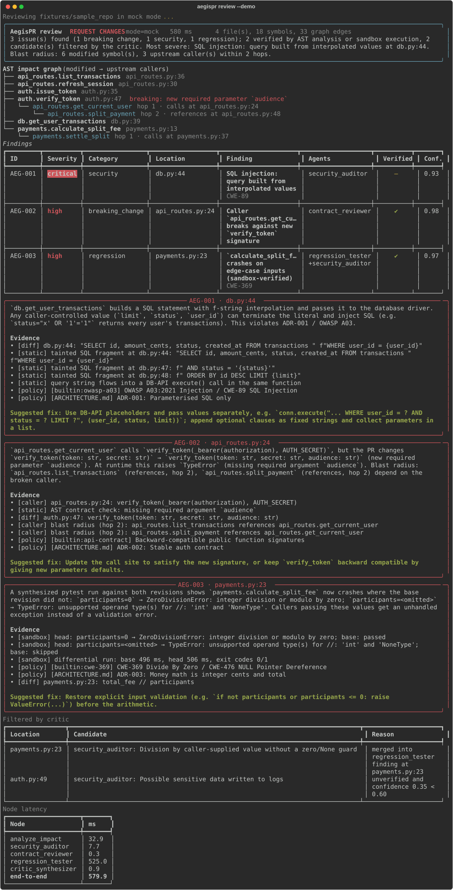
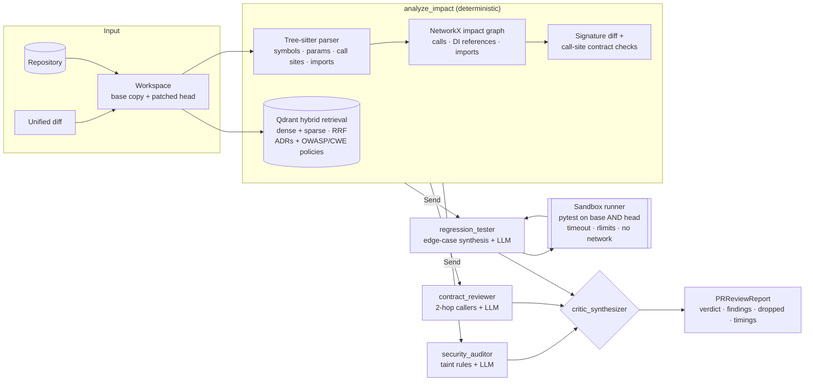
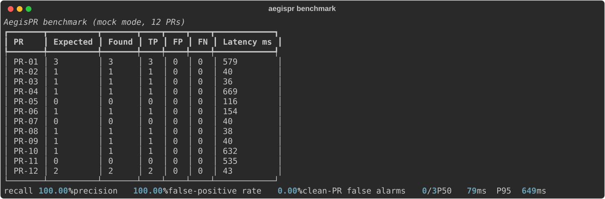

# AegisPR

[](https://github.com/sreenivasreddy037/aegis-pr/actions/workflows/ci.yml)

[](LICENSE)

**Autonomous multi-agent code review, AST impact graph, and regression verifier.**

AegisPR reviews a pull request the way a senior engineer does. It works out what the change
touches across the whole repository, has three specialist agents review it in parallel, runs
generated tests to prove regressions, and hands the results to a critic that removes anything it
cannot ground in the code.

```bash
uv run aegispr review --demo        # works offline, no API key
```

<p align="center">
  
  <br><em>Real output of <code>aegispr review --demo</code> on the bundled sample PR (offline mode).</em>
</p>

---

## Why naive diff-prompting fails

Pasting `git diff` into an LLM works for single-file cosmetic changes. It breaks down on real
multi-file repositories, in three ways:

| Failure mode | Example from the bundled sample PR |
|---|---|
| **Breakage happens outside the diff.** The diff shows `verify_token(token, secret, audience)`. The caller that breaks, `api_routes.get_current_user`, isn't in the diff, so the model never sees it. | The PR updated one caller (`refresh_session`) and forgot the other. |
| **Static guesses aren't evidence.** "This might divide by zero" is noise unless someone shows it actually crashes and that the crash is *new*. | `calculate_split_fee` lost its `participants <= 0` guard. Only running it shows `ZeroDivisionError` on head where base raised a clean `ValueError`. |
| **Hallucinated locations and duplicates.** LLM reviewers invent line numbers, repeat the same issue from several angles, and flag low-confidence trivia. | A sensitive-logging heuristic fires on `logger.debug("verifying token…", audience)`. It only mentions the word "token", so it isn't a real leak. |

AegisPR fixes this in three steps. **Deterministic structure** comes first (tree-sitter AST,
NetworkX call graph, contract checks). **Execution** comes next (a sandboxed differential pytest
run). **Generation** comes last: LLM agents adjudicate and explain the evidence, and a critic
enforces grounding.

## Architecture



The three reviewers run in the **same LangGraph superstep**: `analyze_impact` returns three `Send`
objects. Their outputs merge through `operator.add` reducers, and the critic runs exactly once
after all three finish.

### Components

| Component | What it does |
|---|---|
| **AST engine** (`app/ast_engine/`) | Tree-sitter extracts functions, methods, classes, parameter kinds/defaults, call sites (positional count, keyword names, splats) and imports. Tree-sitter is used because it is error-tolerant. The NetworkX graph has `caller → callee` (calls), `fn → fn` (references, e.g. FastAPI `Depends(get_current_user)`) and `module → symbol` (imports) edges. Changed lines map to their innermost symbols. A reverse BFS then yields 1–2 hop upstream callers with exact snippets and call lines. Every call to a symbol whose signature changed, and every new call, is checked against the new signature. |
| **Hybrid policy retrieval** (`app/retrieval/`) | Qdrant (in-process or server) holds repo ADRs (chunked by heading) plus built-in OWASP/CWE policies. Dense vectors come from fastembed `bge-small` (or a deterministic hashing embedder offline). Sparse vectors are hashed term frequencies with Qdrant's IDF modifier. Two prefetches are fused with RRF, and each agent sends its own query. |
| **Security auditor** | AST-aware rules on the lines a PR adds: SQL built via f-string, `%`, `.format` or `+` that flows into `execute()` (CWE-89); `shell=True` / `os.system` (CWE-78); `eval`/`exec` (CWE-95); credential literals (CWE-798); sensitive values in logs (CWE-532); unsafe deserialization (CWE-502); unguarded division (CWE-369). |
| **Contract reviewer** | Turns AST contract violations into findings with blast radius (callers of the broken caller). Also flags breaking public signatures that have no in-repo callers, and removed symbols that are still called. |
| **Regression tester** | Derives inputs that zero a divisor (`p`→0, `len(p)`→[], `(100 - p)`→100) or exercise an unguarded `None` default. It writes a pytest module and runs it on **both base and head** in parallel sandboxes. A case is a regression only if it fails on head and passed (or did not apply) on base. |
| **Sandbox** (`app/sandbox/`) | Each run gets a throwaway copy, its own process group (SIGKILL on timeout), CPU/file-size (and Linux memory) rlimits, a scrubbed environment (no API keys), socket connects disabled, third-party pytest plugin autoload off, and its own `pytest.ini`. |
| **Critic** | (1) Drops findings whose file/line is not in the diff, or not a known call site for breaking changes. (2) Merges duplicates across agents (same file, ±2 lines, same CWE/category), keeping the verified, most severe one and recording `corroborated_by`. (3) Drops unverified findings below `CONFIDENCE_THRESHOLD`. (4) Assigns IDs and a verdict. Every drop is reported with a reason. |
| **LLM layer** | Live mode uses `ChatOpenAI.with_structured_output` per agent. The LLM can reword, re-rank or reject *unverified* candidates and add up to 3 findings (confidence capped at 0.75). It can never discard verified ones. `MOCK_LLM=true` (or no key) swaps in a deterministic responder, so CI and demos are offline and reproducible. |

## Engineering trade-offs

**AST GraphRAG vs. naive chunking.** Fixed-size chunk retrieval finds text that *looks like* the
diff. It doesn't find the code that *depends on* the diff. The impact graph gives the exact
callers by construction, at a cost of about 30 ms for this repo. The ablation below removes it
(the reviewer only sees files in the diff), and recall drops from 100% to 75%. All three
cross-file breaking changes are missed. The cost is per-language parsers and static resolution
limits: dynamic dispatch and `getattr` are not resolved, and splatted calls are not
contract-checked. This is a deliberate precision-over-recall choice.

**Parallel fan-out.** The reviewers are independent, so their latency is `max` instead of `sum`.
In a test with a simulated 1.5 s LLM call per agent, the agent nodes took 1.5 s, 1.5 s and 2.0 s
(5.0 s serial including impact analysis). End-to-end time with `Send` fan-out was **2.05 s, a
2.5× speedup**. The figure is reproduced by `tests/test_review_pipeline.py::test_agents_run_in_parallel`.
Offline, the sandbox dominates: about 0.5 s for the differential run, itself parallelized across
base and head.

**Execution-verified findings vs. static LLM guesses.** Static "possible division by zero"
findings get confidence 0.5 and are filtered unless corroborated. Sandbox-proven head-only crashes
are `verified=True` (0.97). With the sandbox removed, recall drops from 100% to 75%: the static
guesses don't clear the critic's threshold. Raising their confidence instead would bring the false
positives back on clean PRs. The cost is ~0.5 s per modified function with arithmetic, plus the
operational care that executing code requires.

## Benchmark

`evals/benchmark_prs.json` contains 12 curated PRs against the sample service, generated
reproducibly by `evals/build_benchmark.py`. There are 12 ground-truth issues: 4 breaking changes,
5 security issues and 3 regressions. 3 PRs are clean and measure false alarms. A finding counts as
correct when category, file and enclosing symbol match.

| Configuration (offline, `MOCK_LLM=true`) | Recall | Precision | False-positive rate | Clean-PR false alarms | P50 latency | P95 latency |
|---|---|---|---|---|---|---|
| **Full pipeline** | **100%** (12/12) | **100%** | **0%** | 0 / 3 | 40 ms | 621 ms |
| Ablation: no impact graph (diff-only) | 75% | 100% | 0% | 0 / 3 | 40 ms | 558 ms |
| Ablation: no sandbox (static only) | 75% | 100% | 0% | 0 / 3 | 36 ms | 68 ms |

<p align="center">
  
</p>

These numbers were measured on an Apple Silicon laptop with `uv run aegispr benchmark`
(`ABLATION=...` for the ablation rows). P95 is dominated by the sandbox runs.

> **Read these numbers honestly.** The benchmark is small and was built together with the rule
> set. It is a regression gate for the pipeline, not evidence that the tool generalizes to
> arbitrary repositories. What it does show is the *relative* value of each stage (see the
> ablations). It also shows that the critic keeps precision at 100% while candidates are being
> filtered: 2 of 5 candidates on the seeded PR are dropped. With `OPENAI_API_KEY` set,
> `evals/test_review_eval.py` also scores DeepEval `FaithfulnessMetric` (≥ 0.85) for every
> finding against its retrieved evidence.

## Quickstart

### Prerequisites

| Requirement | Needed for | Install |
|---|---|---|
| [git](https://git-scm.com/downloads) | cloning | preinstalled on macOS/Linux |
| [uv](https://docs.astral.sh/uv/getting-started/installation/) ≥ 0.5 | everything | macOS/Linux: `curl -LsSf https://astral.sh/uv/install.sh \| sh` · Windows: `powershell -c "irm https://astral.sh/uv/install.ps1 \| iex"` · or `pip install uv` |
| Python 3.12 | everything | **nothing to do**: `uv sync` downloads it automatically if missing |
| [Docker](https://docs.docker.com/get-docker/) | optional `docker compose` stack only | Docker Desktop / Engine with Compose v2 |
| OpenAI API key | optional live-LLM mode only | without one, AegisPR runs in deterministic offline mode |

Supported platforms are macOS, Linux and Windows. Sandbox CPU/memory rlimits apply on POSIX
only; on Windows, prefer the Docker stack.

```bash
# 1. Clone and install (creates .venv with Python 3.12 and all dependencies)
git clone https://github.com/sreenivasreddy037/aegis-pr.git
cd aegis-pr
uv sync

# 2. Offline demo: catches all 3 seeded bugs in the sample PR
MOCK_LLM=true uv run aegispr review --demo

# 3. Review your own change
git diff main > change.diff
uv run aegispr review --repo . --diff change.diff --fail-on high     # non-zero exit gates CI
uv run aegispr review --repo . --diff change.diff --json -o report.json
uv run aegispr review --demo --svg docs/demo-review.svg    # regenerate the README screenshot

# 4. Benchmark & tests
uv run aegispr benchmark
MOCK_LLM=true uv run pytest -v
uv run ruff check .

# 5. API (FastAPI) and container
uv run aegispr serve          # GET /health, GET /review/demo, POST /review/diff
docker compose up --build     # API + Qdrant server
curl -s localhost:8000/review/demo | jq '.findings[] | {id, severity, title, file_path, line}'
```

Live LLM mode: `cp .env.example .env`, set `OPENAI_API_KEY`, and set `MOCK_LLM=false`.
The first live run downloads the ~130 MB `bge-small` embedding model; set `EMBEDDING_BACKEND=hash`
to skip it.

### Troubleshooting

| Symptom | Fix |
|---|---|
| `uv: command not found` | Install uv (see Prerequisites), then open a new terminal so it's on your `PATH`. |
| `aegispr: command not found` | Run it through uv: `uv run aegispr ...` (or `source .venv/bin/activate` first). |
| Port 8000 already in use | `uv run aegispr serve --port 8080`, or change the port mapping in `docker-compose.yml`. |
| `diff does not apply` (HTTP 422) | The diff must be generated against the exact repo state you pass as `--repo`. |
| Reviews stay in `mode=mock` | `OPENAI_API_KEY` is unset or `MOCK_LLM=true`; check your `.env`. |

### What the demo finds

| ID | Severity | Finding | How it's proven |
|---|---|---|---|
| AEG-001 | critical | SQL injection in `db.get_user_transactions` (`status`, `limit`, `user_id` interpolated into SQL that reaches `execute`) | AST taint rule + ADR-001 + OWASP A03 |
| AEG-002 | high | `api_routes.get_current_user` (`api_routes.py:24`) calls `verify_token` without the new required `audience`. The blast radius covers the `list_transactions` and `split_payment` routes. | AST impact graph + call-site contract check |
| AEG-003 | high | `calculate_split_fee` crashes on `participants=0` (`ZeroDivisionError`) and when `participants` is omitted (`TypeError`) | Differential sandbox run: head fails, base passes |

The critic filtered two candidates: a duplicate static division warning (merged into AEG-003) and
a 0.35-confidence logging heuristic.

## Configuration

| Variable | Default | Meaning |
|---|---|---|
| `OPENAI_API_KEY` | – | Enables live mode (otherwise offline) |
| `OPENAI_MODEL` | `gpt-4o-mini` | Model for agents, critic summary and DeepEval judge |
| `MOCK_LLM` | `false` | Force deterministic offline responders |
| `QDRANT_MODE` | `local` | `local` (in-process) or `remote` (`QDRANT_URL`) |
| `EMBEDDING_BACKEND` | `auto` | `hash` offline, `fastembed` online, `auto` picks |
| `SANDBOX_TIMEOUT_SEC` | `10` | Hard wall-clock limit per sandbox run |
| `CONFIDENCE_THRESHOLD` | `0.6` | Critic cut-off for unverified findings |
| `ALLOWED_REPO_ROOT` | `fixtures/` | API may only review repos under this directory |

## Security notes

The API applies an untrusted diff and executes generated tests that import the patched code, so
the sandbox is a key boundary. Subprocess isolation (rlimits, scrubbed env, no sockets, timeouts)
is defence in depth, not a jail. For untrusted input, run the provided container: non-root,
read-only root filesystem, `no-new-privileges`. Ideally add gVisor/Firecracker. `repo_path` is
confined to `ALLOWED_REPO_ROOT`, and patches cannot write outside the workspace.

## Roadmap

- Execution-verified SQL injection: run the query builder against in-memory SQLite with payloads.
- Additional tree-sitter grammars (TypeScript, Go) behind the same `ImpactGraph` interface.
- GitHub App integration that posts findings as review comments, with incremental re-review.
- Persistent Qdrant index per repository with commit-keyed invalidation.

## Project layout

See [AGENTS.md](AGENTS.md) for the directory map, commands and architectural invariants.

## License

MIT
